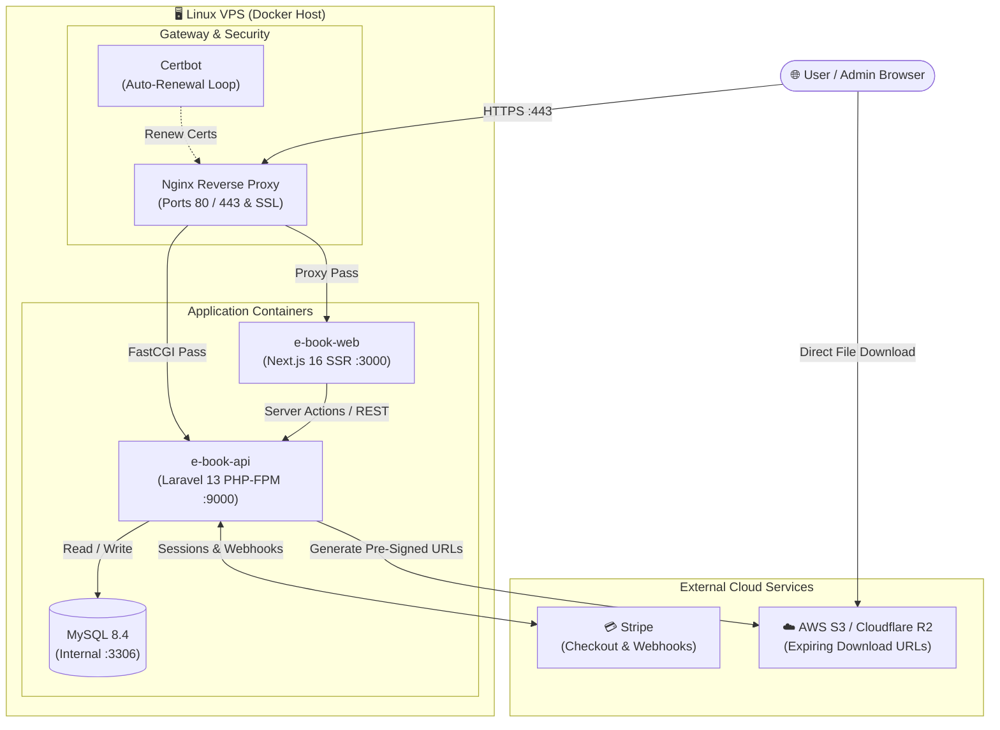

# 📚 E-Book Platform — System Orchestration (`e-book-orchi`)

Containerized deployment and infrastructure orchestration for the full-stack **E-Book Commerce & Digital Asset Delivery Platform**, powered by **Docker Compose**, **Nginx**, **Let's Encrypt (Certbot)**, **Next.js**, **Laravel**, and **MySQL**.

---

## 🔗 Quick Links & Live Demo

| Resource                      | Link                                                                                       | Description                                                   |
| :---------------------------- | :----------------------------------------------------------------------------------------- | :------------------------------------------------------------ |
| **🌐 Customer Storefront**    | [https://e-book.nayhtetkhant.com](https://e-book.nayhtetkhant.com)                         | Live production storefront for browsing & purchasing e-books  |
| **🔐 Admin Portal**           | [https://e-book.nayhtetkhant.com/admin/login](https://e-book.nayhtetkhant.com/admin/login) | Administrator login for inventory, orders & payment analytics |
| **🖥️ Frontend Repository**    | [nayhtetkhant/e-book-web](https://github.com/nayhtetkhant/e-book-web)                      | Next.js 16 + React 19 + TypeScript + Tailwind CSS             |
| **⚙️ Backend API Repository** | [nayhtetkhant/e-book-api](https://github.com/nayhtetkhant/e-book-api)                      | Laravel 13 (PHP 8.4-FPM) + Sanctum + Cashier + AWS S3         |

### 💳 Demo & Testing Credentials

- **Stripe Test Card**: `4242 4242 4242 4242`
    - _Expiration_: Any future month/year (e.g., `12/30`)
    - _CVC_: Any 3 digits (e.g., `123`)
    - _ZIP_: Any numeric code (e.g., `10001`)

---

## 💡 Concept & Core Architecture

### What is `e-book-orchi`?

`e-book-orchi` is the central orchestration repository that ties together all independent micro-services of the platform into a reproducible, single-command Docker deployment on any Linux Virtual Private Server (VPS).

### Core Concepts

1. **Decoupled Client & Server**:
    - The **Frontend** (`e-book-web`) is a server-rendered Next.js application handling high-performance customer browsing, cart state, and administrator interfaces.
    - The **Backend** (`e-book-api`) is a stateless REST API powered by Laravel, handling relational data, authentication tokens (Sanctum), business logic, and payment fulfillment.
2. **Secure Digital Asset Delivery**:
    - E-book PDF and EPUB files are never exposed publicly or stored directly in public web directories.
    - Files are stored in secure cloud object storage (AWS S3 / Cloudflare R2).
    - Once a customer completes a purchase, the API validates the ownership record and issues a temporary **pre-signed download URL** that automatically expires after **10 minutes**.
3. **Webhook-Driven Payment Lifecycle**:
    - Customers check out using **Stripe Checkout**.
    - Fulfillment does not rely on browser redirects (which can fail if the user closes their tab). Instead, Stripe sends an asynchronous webhook event (`checkout.session.completed`) directly to the backend.
    - A database transaction verifies the payment amount, marks the order and payment as `paid`, and attaches the purchased book rights to the customer's account.
4. **Automated SSL & Reverse Proxy Gateway**:
    - **Nginx** handles all incoming HTTP/HTTPS traffic on ports 80 and 443.
    - Traffic is routed seamlessly: domain-level routing directs web requests to Next.js on port 3000 and API requests to Laravel via FastCGI on port 9000.
    - **Certbot** issues genuine Let's Encrypt SSL certificates and continuously runs a background loop to renew certificates every 12 hours.

---

## Architecture Diagrams

### Simple System Diagram



### High-Level Request Flow (ASCII)

```text
+-----------------------------------------------------------------------------------+
|                                 CLIENT BROWSER                                    |
+-----------------------------------------------------------------------------------+
        | (HTTPS / e-book.nayhtetkhant.com)         | (HTTPS / e-book-api...)
        v                                           v
+-----------------------------------------------------------------------------------+
|                        NGINX REVERSE PROXY & SSL (Port 443)                       |
+-----------------------------------------------------------------------------------+
        |                                           |
        | proxy_pass :3000                          | fastcgi_pass :9000
        v                                           v
+-------------------------------+           +---------------------------------------+
|   FRONTEND (e-book-web)       |           |          BACKEND (e-book-api)         |
|   Next.js 16 / TypeScript     | --------> |          Laravel 13 / PHP 8.4         |
+-------------------------------+  REST     +---------------------------------------+
                                                       |               |         |
                              +------------------------+               |         |
                              | DB Queries                             |         |
                              v                                        |         |
                   +---------------------+                             |         |
                   |   DATABASE (mysql)  |                             |         |
                   |      MySQL 8.4      |                             |         |
                   +---------------------+                             |         |
                                                                       |         |
                                  Checkout & Webhooks                  |         |
              Stripe API <=============================================+         |
                                                                                 |
                                  Pre-Signed URLs (10-min expiry)                |
              AWS S3 / R2 <======================================================+
```

---

## 🗂️ Project Directory Structure

```text
e-book-orchi/
├── docker-compose.yml          # Container stack orchestration definition
├── DEPLOYMENT.md               # Detailed technical deployment reference
├── init-ssl.sh                 # Let's Encrypt certificate automation script
├── .env.example                # Template for orchestration environment variables
├── .env                        # Active orchestration environment variables
├── certbot/
│   ├── conf/                   # Mounted Let's Encrypt certificate directory
│   └── www/                    # ACME webroot challenge directory
├── nginx/
│   ├── Dockerfile              # Custom Nginx Alpine image with OpenSSL
│   ├── docker-entrypoint.sh    # Self-signed fallback cert generator & reload loop
│   ├── nginx.conf              # Main Nginx process configuration
│   └── conf.d/
│       ├── default.conf        # Default drop/catch-all configuration
│       ├── e-book-fe.conf      # Reverse proxy configuration for Next.js web
│       └── e-book-be.conf      # FastCGI proxy configuration for Laravel API
├── e-book-web/                 # Git submodule / directory: Next.js Frontend
└── e-book-api/                 # Git submodule / directory: Laravel Backend API
```

---

## 🚀 Step-by-Step VPS Deployment Guide

This guide walks you through setting up and running the entire platform from scratch on a clean Linux VPS (Ubuntu 22.04 / 24.04 LTS).

### 1. VPS Prerequisites

Ensure your VPS has:

- At least **1 GB RAM** and **1 vCPU** (2 GB RAM recommended for builds).
- A public IPv4 address.
- Ports **80** and **443** open in your firewall.

Connect to your VPS and install Docker & Docker Compose:

```bash
# Update packages
sudo apt update && sudo apt upgrade -y

# Install Docker & Docker Compose plugin
curl -fsSL https://get.docker.com -o get-docker.sh
sudo sh get-docker.sh

# Enable Docker without root (optional)
sudo usermod -aG docker $USER
newgrp docker

# Verify installation
docker --version
docker compose version
```

Configure your firewall (UFW):

```bash
sudo ufw allow OpenSSH
sudo ufw allow 80/tcp
sudo ufw allow 443/tcp
sudo ufw enable
```

---

### 2. DNS Configuration

In your DNS provider (e.g., Cloudflare, Namecheap, Route 53), add **A records** pointing to your VPS public IP:

| Type | Name / Host  | Target IP       | Notes                              |
| :--- | :----------- | :-------------- | :--------------------------------- |
| `A`  | `e-book`     | `<YOUR_VPS_IP>` | Maps `e-book.nayhtetkhant.com`     |
| `A`  | `e-book-api` | `<YOUR_VPS_IP>` | Maps `e-book-api.nayhtetkhant.com` |

> ⚠️ **Important (Cloudflare Users)**: Initially set proxy status to **DNS Only (Gray Cloud)** so Let's Encrypt can verify the HTTP ACME challenge. You can turn on Cloudflare proxying afterwards if desired.

---

### 3. Clone the Repositories

Clone the orchestration repository along with the frontend and backend repositories into your deployment folder:

```bash
# Clone the orchestrator
git clone https://github.com/nayhtetkhant/e-book-orchi.git ~/e-book
cd ~/e-book

# Clone frontend and backend repositories into their respective folders
git clone https://github.com/nayhtetkhant/e-book-web.git e-book-web
git clone https://github.com/nayhtetkhant/e-book-api.git e-book-api
```

---

### 4. Configure Environment Variables

The application requires environment configuration at three levels:

#### A. Root Orchestrator `.env`

Create the root `.env` from the example:

```bash
cp .env.example .env
```

Adjust the values inside `.env`:

```ini
DB_DATABASE=e_book_api
DB_USERNAME=root
DB_PASSWORD=your_super_secure_db_password

APP_URL=https://e-book-api.nayhtetkhant.com
FRONTEND_URL=https://e-book.nayhtetkhant.com

NODE_ENV=production
API_BASE_URL=https://e-book-api.nayhtetkhant.com

SSL_ADMIN_EMAIL=your-email@example.com
```

#### B. Backend API `.env` (`e-book-api/.env`)

Configure the Laravel backend:

```bash
cp e-book-api/.env.example e-book-api/.env
```

Key settings in `e-book-api/.env`:

```ini
APP_NAME="E-Book API"
APP_ENV=production
APP_KEY=                        # Will be generated in step 6
APP_DEBUG=false
APP_URL=https://e-book-api.nayhtetkhant.com
FRONTEND_URL=https://e-book.nayhtetkhant.com

# Database (matches root .env values)
DB_CONNECTION=mysql
DB_HOST=mysql
DB_PORT=3306
DB_DATABASE=e_book_api
DB_USERNAME=root
DB_PASSWORD=your_super_secure_db_password

# Stripe
STRIPE_KEY=pk_test_...
STRIPE_SECRET=sk_test_...
STRIPE_WEBHOOK_SECRET=whsec_...

# Storage (AWS S3 or Cloudflare R2)
FILESYSTEM_DISK=s3
AWS_ACCESS_KEY_ID=your_access_key
AWS_SECRET_ACCESS_KEY=your_secret_key
AWS_DEFAULT_REGION=auto
AWS_BUCKET=your-bucket-name
AWS_ENDPOINT=https://<account_id>.r2.cloudflarestorage.com
AWS_USE_PATH_STYLE_ENDPOINT=false
```

#### C. Frontend Web `.env` (`e-book-web/.env`)

Configure the Next.js frontend:

```bash
cat <<EOF > e-book-web/.env
API_BASE_URL=https://e-book-api.nayhtetkhant.com
EOF
```

---

### 5. Build and Launch Containers

Build images and bring up the services in detached mode:

```bash
docker compose up -d --build
```

Verify that all 4 primary services (`e-book-nginx`, `e-book-web`, `e-book-api`, `e-book-mysql`) are up and healthy:

```bash
docker compose ps
```

> 💡 **Notice**: On initial startup, Nginx automatically generates a temporary self-signed certificate so that it can start immediately without crashing, allowing port 80 to respond to the Let's Encrypt validation challenge.

---

### 6. Initialize Laravel Application

Run the database migrations, generate application keys, and seed the demo data:

```bash
# Generate encryption key
docker compose exec e-book-api php artisan key:generate --force

# Run database migrations and seeders
docker compose exec e-book-api php artisan migrate:fresh --seed --force

# Create public storage symlink
docker compose exec e-book-api php artisan storage:link

# Optimize Laravel configuration, routes, and views
docker compose exec e-book-api php artisan optimize
```

---

### 7. Provision Let's Encrypt SSL Certificates

Run the automated SSL script with your administrative email:

```bash
chmod +x init-ssl.sh
./init-ssl.sh your-email@example.com
```

This script:

1. Verifies Nginx is serving ACME challenges via webroot.
2. Requests genuine Let's Encrypt certificates for the configured domains.
3. Automatically reloads Nginx with production TLS 1.2/1.3 and HTTP/2 enabled.
4. Leaves the Certbot container running a quiet renewal check every 12 hours.

Your platform is now live with full HTTPS encryption! 🚀

---

## 🛠️ Management & Maintenance

### Monitoring Logs

```bash
# View live logs for all services
docker compose logs -f

# Follow specific service logs
docker compose logs -f nginx
docker compose logs -f e-book-web
docker compose logs -f e-book-api
docker compose logs -f mysql
docker compose logs -f certbot
```

### Running Laravel Artisan Commands

```bash
# Run database migrations
docker compose exec e-book-api php artisan migrate --force

# Clear and rebuild cache
docker compose exec e-book-api php artisan optimize:clear
docker compose exec e-book-api php artisan optimize

# Enter interactive tinker shell
docker compose exec e-book-api php artisan tinker
```

### Updating Code & Zero-Downtime Rebuild

When pushing new changes to the frontend or backend:

```bash
# Pull latest changes
cd e-book-web && git pull && cd ..
cd e-book-api && git pull && cd ..

# Rebuild and restart updated containers
docker compose up -d --build --no-deps e-book-web
docker compose up -d --build --no-deps e-book-api

# Re-run migrations and cache refresh if needed
docker compose exec e-book-api php artisan migrate --force
docker compose exec e-book-api php artisan optimize
```

### Database Backup & Restore

```bash
# Create a backup
docker compose exec mysql mysqldump -u root -p'password1@2#' e_book_api > backup_$(date +%Y%m%d).sql

# Restore from a backup
cat backup.sql | docker compose exec -T mysql mysql -u root -p'password1@2#' e_book_api
```

---

## 🔒 Security Best Practices

- **Container Isolation**: The `mysql` database container does not expose port 3306 to the host or internet. It is accessible solely within the internal Docker bridge network (`e-book-net`).
- **Expiring Pre-Signed URLs**: S3/R2 storage buckets remain private. Files are downloaded exclusively via pre-signed URLs with a 10-minute expiry window.
- **Security Headers**: Nginx includes `X-Frame-Options: SAMEORIGIN`, `X-Content-Type-Options: nosniff`, `X-XSS-Protection`, and `Referrer-Policy`.
- **Webhook Signature Verification**: All Stripe webhook requests verify Stripe's signature (`whsec_...`) to prevent replay or spoofing attacks.

---

## 📄 License

This orchestration project and its accompanying repositories are open source under the [MIT License](LICENSE).
